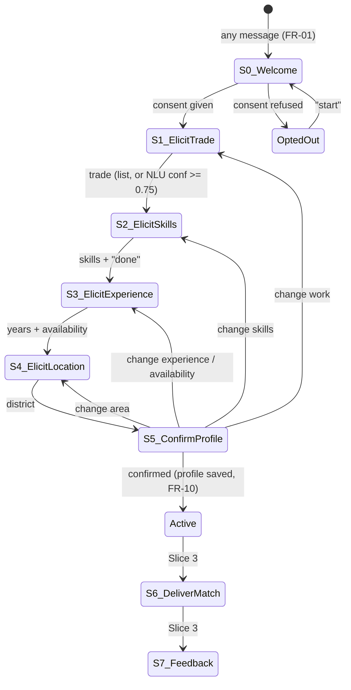

# Conversation design: the skills-elicitation dialogue

How the implemented dialogue maps onto the S&D design (Design §6.2, Figure 3; requirements in
Specification §2). The code is `src/JobMatch.Domain/Conversation/`: `ConversationFsm.cs` holds
the transitions (pure, unit-tested) and `DialoguePrompts.cs` holds every message the bot sends.
Change the wording there.

## States



| S&D state | Enum | What the worker sees | Accepts |
|---|---|---|---|
| S0 WELCOME | `Welcome` | Purpose, data use, how to exit (FR-02); **Yes / No** buttons | 1/2, yes/no |
| S1 ELICIT_TRADE | `ElicitTrade` | "What kind of work do you do?" + **list** of 10 trades | list row, trade name, free text via NLU |
| S2 ELICIT_SKILLS | `ElicitSkills` | That trade's 10 skills as a **list**; after a pick, "Done" + remaining skills | row, numbers "1,3", skill name, free text |
| S3 ELICIT_EXPERIENCE | `ElicitExperience` | Years (3 **buttons**: <1, 1–5, >5), then availability (3 buttons) | buttons, a number ("7"), "since 2018", "mornings only" |
| S4 ELICIT_LOCATION | `ElicitLocation` | **List** of 10 common areas | row, place name or alias, free text, resolved to a **district** |
| S5 CONFIRM_PROFILE | `ConfirmProfile` | Summary of every slot; **Yes / Change something** | yes; change menu (5 slots); a correction with the new value |
| S6 DELIVER_MATCH, S7 FEEDBACK | `DeliverMatch`, `Feedback` | Not reachable yet: arrive with the matching engine (Slice 3) | |
| (rest) | `Active` | Profile saved; commands | feedback (NLU), commands |
| EXIT | `OptedOut` | Silent | "start", "delete" |

The tables of trades, skills and areas are not in code: they come from `nlp/data/taxonomy_v1.json`
(`trade_menu`) and `nlp/data/localities_v1.json` (`location_menu`). These are the same files the
NLU service resolves against, so the menus and the models always agree.

## Rules

- **Mixed initiative (system-directed with user override).** The bot asks slot by slot, but any
  slot the worker fills early is kept and its question skipped. "Am a mason, I lay blocks and
  plaster, 6 yrs" fills trade, two skills and experience in one turn.
- **Confidence (S&D L4: 0.75).** At or above 0.75 a value is used directly. Between 0.45 and 0.75
  it is put back as a yes/no question ("Do you work in Carpentry?"), logged as `Clarify`, not a
  repair. Below 0.45 it is ignored.
- **3-strike clarification.** A failed turn gets a targeted re-ask (FR-08) and counts a strike.
  The 3rd consecutive failure in one state sends the human-handoff message, logs intent
  `HumanHandoff`, and resets the count. Any progress, or moving state, resets it.
- **Confirmation before saving (FR-10).** Consent creates the worker row. The skills profile
  (trade, skills with source utterance and confidence, experience, availability, district) is
  written only when the worker confirms the S5 summary. Re-confirming after a change syncs the
  skills: dropped skills get `RemovedUtc` and are never hard-deleted.
- **Corrections (Figure 3 correction path).** "Change something" offers the 5 slots; the chosen
  slot is cleared and re-asked, and the flow returns to S5 because every other slot is still
  filled. A correction that carries its value ("no, my area is Tema") is applied directly.
- **Global commands, any state.** `help`, `stop`, `update` (FR-15), `skills`, `matches`,
  `delete` (FR-16, confirmed first; removes the worker, skills, matches, every logged message and
  the session). Matching is on the whole message, so "I can stop leaks" isn't "stop".
- **NLU-recognised requests.** A free-text help request ("i no understand") gets help. An exit
  request ("leave me alone", "later") is confirmed before opting out, because a pause shouldn't
  unsubscribe anyone.
- **Interaction modes (NFR-07).** Buttons and lists carry ids equal to what a worker could type
  ("1", "done"), so a tap and a typed answer follow the same path. Every option is also readable
  in the text.
- **Message length (NFR-05).** No outbound message exceeds 500 characters; a longer one is split
  at paragraph boundaries with its buttons on the last part.
- **Sessions (FR-09).** Kept 72 hours (sliding), so an unfinished profile can be resumed.
- **What's analysed (DL-010, DL-014).** NLU runs only after consent, and not on taps or bare menu
  numbers.

## Deliberate differences from the S&D text

| S&D | Implemented | Why |
|---|---|---|
| S0 asks consent only; English-only (FR-03) | The Slice 1 language and name steps were removed | No language choice exists in the pilot; name is optional under data minimisation (NFR-09) |
| S2 "Quick Reply buttons for common skills" | A List Message of the trade's skills | Buttons hold 3 options, a list 10; every trade has 10 skills |
| S3 "specific days" availability | Full-time / Part-time / Weekends only buttons, plus free text via NLU | Keeps a 3-button choice; any other answer is kept as typed |
| Figure 3 "EXIT: human handoff" after 3 strikes | Handoff message, then the conversation continues | The worker isn't stranded while waiting for a person |
| S6/S7 | Defined, not yet reachable | They need the matching engine (Slice 3) |

## Typical session (9 turns, S&D target ≤ 12)

```
USER hello                         BOT welcome + consent             [Yes, I agree | No]
USER (tap) Yes                     BOT what kind of work?            [list: 10 trades]
USER am a mason, i lay blocks and plastring for 6 yrs
                                   BOT your skills: Block laying, Plastering. Anything else?  [Done | ...]
USER i do tiling too               BOT ...Tiling. Anything else?
USER (tap) Done                    BOT when can you work?            [Full-time | Part-time | Weekends only]
USER full time                     BOT which area?                   [list: 10 areas]
USER i stay near lapaz market      BOT summary (Area: Lapaz market (Ablekuma North))  [Yes | Change]
USER no my area is kaneshie        BOT Updated, summary (Kaneshie (Ablekuma Central))
USER (tap) Yes                     BOT profile saved
```
(Experience was never asked: "6 yrs" filled it in turn 3.)
